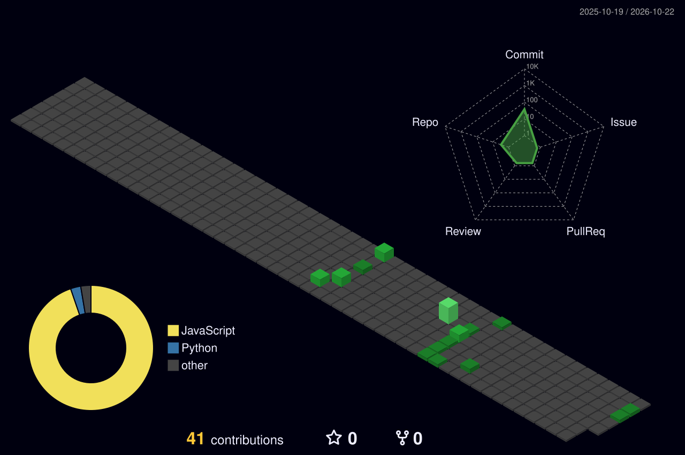

<!--
  github.com/Aditya132005 · custom terminal theme
  header / neofetch / footer art lives in ./assets (hand-built animated SVG, no external services)
  3D calendar + snake are generated by .github/workflows/profile-art.yml
-->

<div align="center">



<br/><br/>

<a href="https://joinhustle.in"></a>


</div>

<br/>



## `$ ls ~/stack`

<p align="center">
  <a href="https://skillicons.dev">
    
  </a>
</p>

## `$ ps aux | grep building`

```text
USER     PROCESS                STATUS     WHAT
aditya   hustle                 running    brands x short-form creators, paid on CPM
aditya   voicedesk              running    B.Tech capstone project
aditya   social-discovery-app   queued     college events app: campus feed + public explore
```

## `$ ls ~/projects`

| repo | what it is | lang |
| :-- | :-- | :-- |
| [**NetraKiran**](https://github.com/Aditya132005/NetraKiran) | website for an optical shop, built and maintained for a real client | JavaScript |
| [**Netra-Gem**](https://github.com/Aditya132005/Netra-Gem) | optical shop web front-end | HTML |
| [**Retail-revenue-analytics-**](https://github.com/Aditya132005/Retail-revenue-analytics-) | retail revenue analytics | Python |
| [**HUSTLE**](https://joinhustle.in) | CPM marketplace linking brands with short-form creators | Node.js |

## `$ git log --graph`

<!-- generated nightly by the profile-art workflow -->


<picture>
  <source media="(prefers-color-scheme: dark)" srcset="https://raw.githubusercontent.com/Aditya132005/Aditya132005/output/github-snake-dark.svg"/>
  <source media="(prefers-color-scheme: light)" srcset="https://raw.githubusercontent.com/Aditya132005/Aditya132005/output/github-snake.svg"/>
  
</picture>

## `$ ./contact.sh`

<p align="center">
  <a href="https://joinhustle.in"></a>
  <!-- add yours, e.g.:
  <a href="https://www.linkedin.com/in/YOUR_HANDLE"></a>
  <a href="https://instagram.com/YOUR_HANDLE"></a>
  -->
</p>


